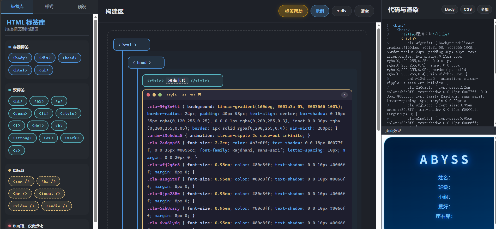
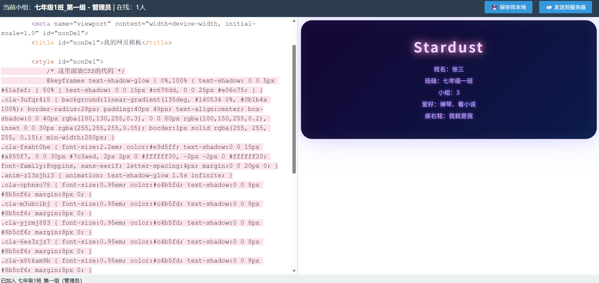

# 网页协作与模块化教学工具包

## 项目说明

本工具包用于在线网页协作的网页编辑、美化与教学内容，主要面向教室局域网教学场景。前端工具以模块化网页编辑工具为主，兼顾预设与代码分离功能，帮助教师更形象、更条理地开展 HTML 教学；同时附带有在线合作网页编辑工具包，让学生能够在教室局域网下进行高效学习、协作编辑与作品提交。

## 核心能力

- **模块化网页编辑**：通过模块组合理解网页结构，降低 HTML 学习门槛。
- **预设与代码分离**：先看效果，再学代码，便于教师分步骤讲解。
- **在线合作编辑**：支持教室局域网内多人协作网页编辑。
- **实时预览与美化**：帮助学生直观看到页面变化，提升学习反馈效率。
- **学生作品保存**：学生提交内容统一保存，便于教师查看与管理。
- **班级信息管理**：通过 `classes.json` 维护班级相关信息。
- **轻量部署**：教师机启动服务端，学生端分发 `students_portal` 文件夹即可使用。

## 适用场景

- 中小学信息技术课 HTML 入门教学
- 教室局域网内的网页编辑与协作实践
- 教师演示模块化网页搭建与代码分离
- 学生分组合作完成网页作品并提交保存
- 教研、培训场景中的网页编辑教学演示

## 预览效果

> 预览效果图如下：
<p align="center">
  
</p>

<p align="center">
  
</p>

## 文件夹目录

目录结构如下：

```text
.
├── documentation/        # 使用说明文档
├── public/               # 网页显示的初始页面
├── saved/                # 学生提交内容的保存文件夹
├── students_portal/      # 学生端的模块化工具和协作前端工具
├── classes.json          # 班级信息管理文件
└── server.js             # 服务端启动文件
```

## 使用说明

### 1. 启动服务端

启动时应优先启动 `server.js` 服务端文件并确认是否安装ws：

ws安装方法如下，请先在教师机和server.js同级目录下安装ws:

```bash
npm install ws
```

安装后启动:

```bash
node server.js
```


启动前请先打开 `server.js` 查看 Port 端口是否与其他应用冲突，默认端口为 `8848`。

### 2. 配置学生端

在 `students_portal/Client.html` 中搜索编辑 `<script>` 中如下两个属性：

```js
const SERVER_IP = '{填写教师机IP}';
const SERVER_PORT = '{填写教师机开放端口默认8848}';
```

请根据实际教室网络环境填写，例如：

```js
const SERVER_IP = '192.168.1.100'; // 教师机局域网 IP
const SERVER_PORT = 8848;          // 默认 8848，若修改请保持两端一致
```

> 注意：`SERVER_PORT` 为数字类型，不要添加引号。

### 3. 分发学生端

使用时注意填写好对应内容后，只需要给学生分发 `students_portal` 文件夹即可。

教师机上通过命令行指令运行 `server.js` 即可开始使用。

### 4. 开始使用

教师机保持 `node server.js` 运行，学生打开 `students_portal/Client.html` 即可进入编辑与协作界面。

## 配置说明

| 配置项 | 所在文件 | 默认值 / 示例 | 说明 |
| --- | --- | --- | --- |
| Port | `server.js` | `8848` | 服务端监听端口，启动前请确认无端口冲突 |
| `SERVER_IP` | `students_portal/Client.html` | `192.168.1.100` | 教师机局域网 IP，学生端通过该地址连接教师机 |
| `SERVER_PORT` | `students_portal/Client.html` | `8848` | 教师机开放端口，需与 `server.js` 保持一致 |
| 班级信息 | `classes.json` | - | 用于管理班级相关信息 |
| 学生提交内容 | `saved/` | - | 保存学生提交的作品内容 |

## 使用流程

1. 教师机启动 `server.js`，注意这里需要使用Node.js安装ws`npm install ws`再使用`node server.js`。
2. 确认服务端端口未被占用，默认端口为 `8848`。
3. 修改 `students_portal/Client.html` 中的 `SERVER_IP` 与 `SERVER_PORT`。
4. 将 `students_portal` 文件夹分发给学生。
5. 学生打开 `Client.html`，进行网页编辑、美化与协作。
6. 学生提交内容自动保存至 `saved/` 文件夹。
7. 教师可通过 `classes.json` 管理班级信息，并结合 `documentation/` 查看使用文档。

## 注意事项

- 教师机与学生机需处于同一局域网内。
- 学生端填写 `SERVER_IP` 时，应填写教师机的局域网 IP，不要填写 `localhost` 或 `127.0.0.1`。
- 若学生端无法连接，请检查教师机 IP、端口以及防火墙设置。
- 若 `8848` 端口被占用，请修改 `server.js` 中的端口，并同步修改 `students_portal/Client.html` 中的 `SERVER_PORT`。
- 分发时只需分发 `students_portal` 文件夹，无需分发整个项目。
- 请确保 `saved/` 文件夹具有可写权限，以便正常保存学生提交内容。
- 修改 `classes.json` 前建议先备份，避免班级信息丢失。
- 教师机需要保持 `node server.js` 运行，学生端才能正常连接与协作。

## 常见问题

**Q：学生端打不开或无法连接？**

A：请检查发放的Client.html中 `SERVER_IP` 是否为教师机局域网 IP，`SERVER_PORT` 是否与 `server.js` 一致，并确认防火墙已放行对应端口。

**Q：端口冲突怎么办？**

A：打开 `server.js` 修改默认端口，同时修改 `students_portal/Client.html` 中的 `SERVER_PORT`，保持两端一致。

**Q：学生提交的内容保存在哪里？**

A：保存在项目根目录的 `saved/` 文件夹中。

**Q：如何管理班级信息？**

A：编辑根目录下的 `classes.json` 文件进行维护。

**Q：教师机需要一直运行吗？**

A：是的，教师机需要保持 `node server.js` 运行，学生端才能正常连接与协作。

**Q：为什么我用node server.js无法启动服务端**

A：你需要查看教师机电脑是否安装ws，如果没有则需要安装后使用,如果安装了Node.js后还是无法运行请检查是否开放了npm的许可，

## 后续规划

- 丰富模块化网页编辑组件。
- 增强多人协作与权限管理能力。
- 提供更多教学预设与示例模板。
- 优化学生作品管理与课堂展示体验。
- 完善使用文档与教学案例。

## 贡献与反馈

欢迎通过 Issue 或 Pull Request 提交建议与改进。若用于教学场景，也欢迎反馈实际使用体验，帮助工具包持续迭代。

## License

本项目基于 [MIT License](LICENSE) 开源。

Copyright (c) 2026 WangZeZhou(@Komin)

允许任何人免费使用、复制、修改、合并、发布、分发、再许可和/或销售本软件副本，但需保留版权声明和许可声明。

详见 [LICENSE](LICENSE) 文件。
